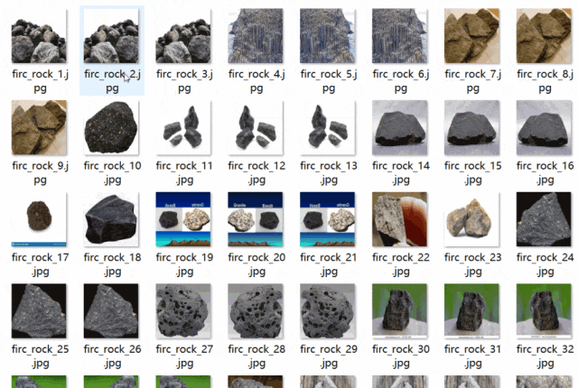
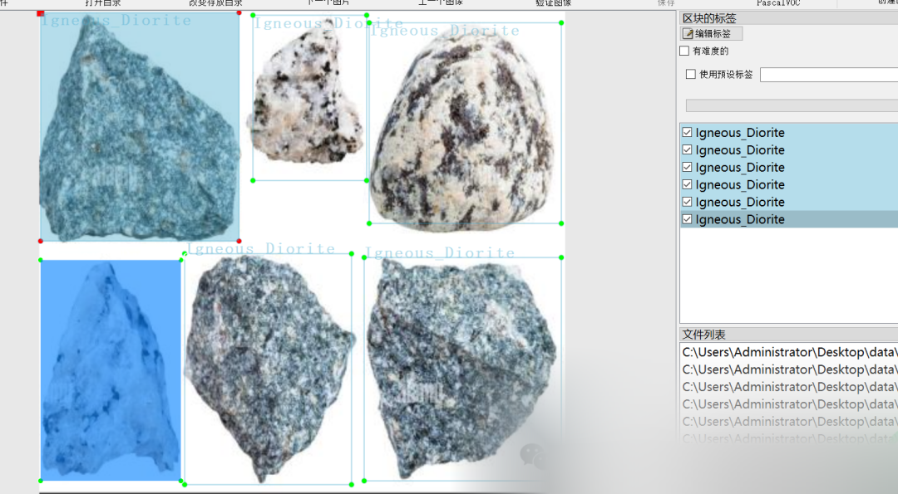

# [Dataset] Object Detection

Dataset format: Pascal VOC format + YOLO format (txt files without split paths, only containing jpg images and corresponding VOC format xml files and yolo format txt files)
Number of images (jpg file count): 4766
Number of annotations (xml file count): 4766
Number of annotations (txt file count): 4766
Number of annotation categories: 9
Annotation category names: ["Igneous_Basalt", "Igneous_Diorite", "Igneous_Granite", "Metamorphic_Marble", "Metamorphic_Quartize", "Sedimentary_Chalk", "Sedimentary_Limestone", "Sedimentary_Sandstone", "Sedimentary_coal"]
Number of boxes per category:
Igneous_Basalt boxes = 659
Igneous_Diorite boxes = 673
Igneous_Granite boxes = 486
Metamorphic_Marble boxes = 1995
Metamorphic_Quartize boxes = 2003
Sedimentary_Chalk boxes = 1019
Sedimentary_Limestone boxes = 3540
Sedimentary_Sandstone boxes = 2127
Sedimentary_coal boxes = 3548
Total number of boxes: 16050
Using labelImg for annotation tools
Annotation rules: draw a box around the category
Important note: The second and third parts of the dataset are enhanced images. Please carefully review the image previews before downloading
Special : This dataset does not guarantee the accuracy or precision of the trained models or weight files. The dataset is provided with accurate and reasonable annotations only.

Image Preview:

Annotation example:

## Payment

Here is a pay link on Stripe ( https://buy.stripe.com/3cs8yP7sY87d0vu9AB ). Please contact me lonlonago@foxmail.com after funding $89, and I will send you a complete data files , thank you!

